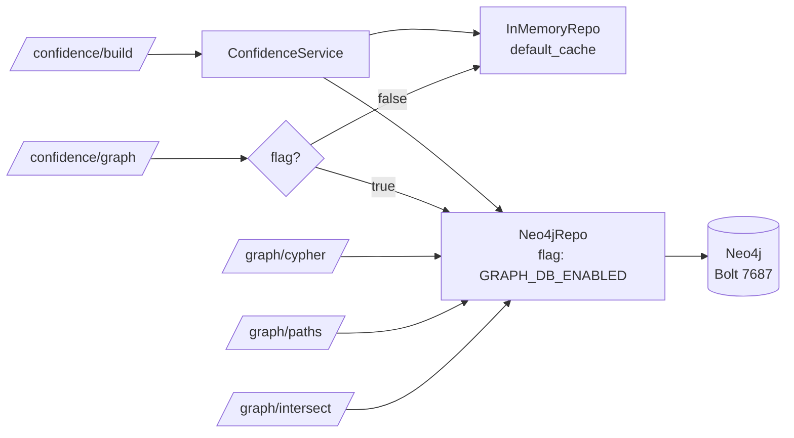
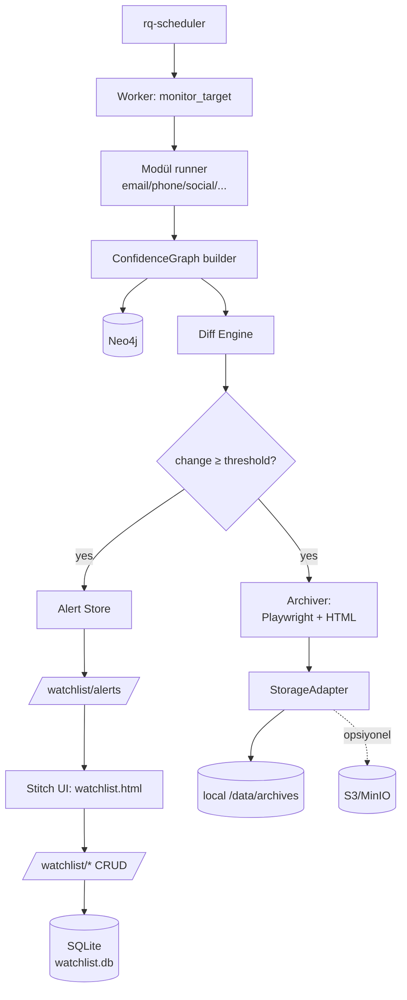
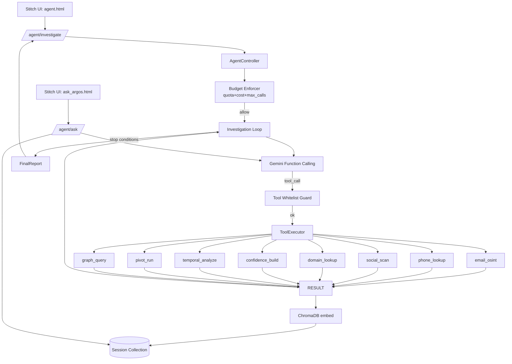
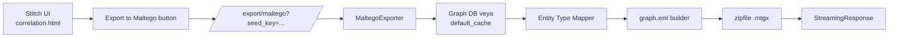

# ARGOS_V2_BLUEPRINT.md

> **Hedef:** ARGOS OSINT v4.0 → v5.0 evrimi. 4 paketle reaktiften proaktife, in-memory'den kalıcı graph'a, pasif LLM'den otonom ajana, izole UI'dan Maltego ekosistemine.
> **Değişmezler:** 478 test PASSED kalmalı · mevcut endpoint URL'leri sabit · her paket bağımsız deploy · Strangler Fig prensibi.
> **Sıra:** Faz 0 (Önkoşul) → Paket 3 (Graph DB) → Paket 2 (Watchlist) → Paket 4 (LLM Ajan) → Paket 1 (Maltego).
> **Onaylanan kararlar:** Neo4j Community · ChromaDB embedded · SQLite+rq+yerel disk+S3 soyutlama · Maltego B-sonra-A · Gemini + tool whitelist + budget limit.

---

## Problem Statement

ARGOS v4 olgun bir reaktif OSINT platformu: tek seferde sorgulanır, sonuç üretir, in-memory cache ile sunar. Bu mimarinin dört temel sınırı var:

1. **Sürdürülebilirlik:** Servis yeniden başladığında confidence graph, pivot session, temporal analiz hepsi kaybolur — uzun süreli istihbarat ürünü oluşamıyor.
2. **Pasiflik:** Hedefler zaman içinde değişiyor; ARGOS yalnızca soruyu siz sorduğunuzda bakıyor.
3. **Sorgu sınırlılığı:** "Bu IP'ye bağlı tüm e-postalar", "iki hedefin ortak noktaları" gibi multi-hop sorgular Python dict'leriyle yapılamıyor.
4. **Manüel pivot:** Strategy-map kural-tabanlı; semantik/yargısal ipucu çıkarımı analist beynine bırakılmış.

Bu blueprint dört sınırı dört pakete eşler ve **stack genişlemesi** (Graph DB sidecar, Redis kuyruk, vektör store, Maltego köprüsü) ile **kontrol katmanları** (budget enforcer, tool whitelist, snapshot diff, audit log) arasında denge kurar.

---

## Background / Mevcut Mimari Doğrulaması

İncelenen dosyalardan tespit:

| Bileşen | Yer | Durum |
|---|---|---|
| FastAPI app + middleware | `app/main.py` | `_safe_include` dinamik router yükleyicisi; yeni router eklemek `routers_to_load` listesine isim eklemekle olur. |
| Confidence | `app/services/confidence/`, `app/models/confidence.py`, `app/routers/confidence.py` | `default_cache: TTL'li in-memory dict`; `ConfidenceGraph` Pydantic; node tipi `FindingType`, edge tipi `EdgeType` enum'ları. |
| Pivot | `app/services/pivot/{orchestrator,executor,strategy_map,session_store,adapters,stubs,expanders/}` | `default_session_store` in-memory; BFS, max_depth, threshold; **kural-tabanlı**. |
| Temporal | `app/services/temporal/{service,cache,narrator,anomalies,clusters,extractors,parsing}` | `default_temporal_cache` in-memory; Türkçe narrator var. |
| Repository pattern | `app/repositories/{base,instagram_repo}.py` | Yalnızca Instagram için; **diğer entity'ler için boş** — Paket 2 buradan faydalanır. |
| Stitch UI | `ui/stitch/{dashboard,profile,correlation,llm_analysis,report}.html` | 5 sayfa, vis.js, fetch tabanlı. |
| Docker | `docker-compose.yml` | Tek servis (`argos:8000`); `env_file: .env`, volume `./logs`. **Profile genişlemesi gerek**. |
| AI altyapı | `app/ai/gemma_local{,_fixed}.py`, `app/services/llm_analyst.py` | Gemini + yerel Gemma 270M var; Gemini function calling henüz kullanılmıyor. |
| Anahtarlar | `.env` | Gemini, Google CSE, NumVerify, LeakCheck, Abstract*, IG, LinkedIn aktif; SauceNAO/HIBP/Shodan **boş**. |
| Requirements | `requirements.txt` | `redis`, `rq`, `playwright`, `google-genai`, `slowapi` var. `arq` **YOK** (brief'te hatalı belirtilmiş — plan `rq` kullanır). |

**Test profili:** 478 test, çoğu unit + integration; Docker testi (`test_docker.py`) ve E2E (`scripts/run_e2e_tests.py`) ayrılmış.

**Kritik gözlem:** Tüm `default_*` singleton'lar in-memory; bunlar **Strangler Fig'in tek dokunma noktası**. Pydantic kontratları korunduğu sürece repository implementasyonu (in-memory → Graph DB) altta değiştirilebilir, üstte hiçbir router/test bunu fark etmez.

---

## Karar Matrisleri

### Neo4j Community vs Memgraph (Paket 3) — KARAR: Neo4j

| Kriter | Neo4j Community 5.x | Memgraph 2.x |
|---|---|---|
| Lisans | GPLv3 (community) | BSL → Apache 2.0 |
| Cypher uyumu | Referans implementasyonu | OpenCypher %95+ |
| Bellek modeli | Disk-first, page cache | Tamamen in-memory + WAL |
| Docker imajı | ~600 MB | ~250 MB |
| Tipik RAM (10K node) | ~512 MB | ~300 MB |
| Browser/UI | Built-in Neo4j Browser | Memgraph Lab (ayrı container) |
| Python driver | `neo4j` resmi, çok olgun | `neo4j` driver bolt uyumlu |
| Bolt protokolü | Var | Var (aynı driver) |
| Topluluk | Çok geniş | Daha küçük |

**Gerekçe:** (a) Bolt driver tek olduğu için Memgraph'a geçiş 1 satır config; (b) doküman bolluğu erken aşamada hız kazandırır; (c) ARGOS Python servisi zaten RAM tutuyor — DB'yi disk-first tutmak toplam RAM bütçesini koruyor; (d) Neo4j Browser, Cypher debug için bedava kazanç.

### ChromaDB vs Qdrant (Paket 4-B) — KARAR: ChromaDB embedded

| Kriter | ChromaDB (embedded) | Qdrant (sidecar) |
|---|---|---|
| Çalışma modu | In-process Python | Ayrı container |
| Persistence | Opsiyonel (DuckDB+Parquet) | Disk-first |
| Ek docker servisi | Hayır | Evet |
| Session-isolated collection | Native | Native |
| RAM (1000 chunk × 768 boyut) | ~50 MB | ~80 MB (container) |
| Cross-session arama | Mümkün ama varsayılan oturum-izole | Çok kolay |

**Gerekçe:** RAG açıkça "session bitince temizle (memory leak önlemi)" — Qdrant'ın kalıcılık avantajı kullanılmıyor; ekstra container yükü gereksiz.

---

## Faz 0 — Önkoşul Altyapı (Cross-cutting)

**Süre:** 1.5–2 gün
**Risk:** Düşük
**Önkoşul:** Yok

### Yapılacaklar

- `requirements.txt` güncelleme (versiyonlar pinli):
  - `neo4j>=5.20,<6` (Paket 3)
  - `rq-scheduler>=0.13` (Paket 2; rq zaten var)
  - `chromadb>=0.5,<0.6` (Paket 4-B)
  - `sentence-transformers>=2.7` (RAG embed; "all-MiniLM-L6-v2")
  - `maltego-trx>=1.6` (Paket 1, opsiyonel)
  - `aiosqlite>=0.20` (Paket 2 watchlist DB, async)
  - `boto3>=1.34` (S3 storage adapter — opsiyonel extra `[s3]`)
- `requirements-dev.txt` ayrımı: `pytest-asyncio`, `pytest-mock`, `httpx[testing]`, `freezegun`.
- `pytest.ini` marker'ları:
  ```ini
  markers =
      graph_db: requires Neo4j running
      docker: requires docker daemon
      e2e: end-to-end full-stack
      slow: > 5s test
  ```
  CI varsayılan: `pytest -m "not graph_db and not docker and not e2e and not slow"` → mevcut 478 testin alt kümesi.
- `.env.example` genişletme:
  ```
  # --- v5 additions ---
  NEO4J_URI=bolt://neo4j:7687
  NEO4J_USER=neo4j
  NEO4J_PASSWORD=changeme
  GRAPH_DB_ENABLED=false
  GRAPH_DB_BACKEND=neo4j
  REDIS_URL=redis://redis:6379/0
  WATCHLIST_DB_PATH=/app/data/watchlist.db
  ARCHIVE_BACKEND=local
  ARCHIVE_LOCAL_PATH=/app/data/archives
  ARCHIVE_S3_BUCKET=
  ARCHIVE_RETENTION_DAYS=90
  AGENT_ENABLED=false
  AGENT_DAILY_TOOL_QUOTA=200
  AGENT_SESSION_MAX_TOOL_CALLS=15
  AGENT_DAILY_BUDGET_USD=5.0
  AGENT_TOOL_WHITELIST=email_osint,phone_lookup,social_scan,domain_lookup,confidence_build,temporal_analyze,pivot_run,graph_query
  CHROMA_PERSIST_DIR=/app/data/chroma
  MALTEGO_API_KEY=
  MAX_WATCHLIST_TARGETS=100
  ```
- `docker-compose.yml` profile sistemi:
  ```yaml
  services:
    argos: { ... }
    neo4j:
      profiles: ["graph", "full"]
    redis:
      profiles: ["queue", "full"]
    minio:
      profiles: ["s3", "full"]
    argos-worker:
      profiles: ["queue", "full"]
  ```
  Default `docker compose up` yalnızca `argos` ayağa kaldırır — geriye uyumlu.
- Dizin oluşumu: `data/`, `data/archives/`, `data/chroma/`, `data/watchlist/`. `.gitignore`'a eklenir; volume mount'ları compose'a yazılır.
- `app/core/config.py` Settings genişletme: yeni env değişkenleri Pydantic Settings field'larına eklenir, default'ları `disabled`.

### Test hedefi
+5 yeni test (config yükleme, env defaults, marker filtering). **Mevcut 478'in hepsi geçmeye devam etmeli.**

### Başarı kriteri
- `pytest -m "not graph_db and not docker"` → 483 PASSED.
- `docker compose up` → `argos` tek başına healthy.
- `docker compose --profile full up` → tüm servisler healthy, `argos` `GRAPH_DB_ENABLED=false` ile başlar.

---


## PAKET 3 — Graph DB Geçişi (Neo4j)

**Süre:** 7–9 gün
**Risk:** Orta
**Önkoşul:** Faz 0
**Strateji:** Strangler Fig — eski `default_cache` (in-memory) kalır, yeni `Neo4jGraphRepository` paralel doldurulur, feature flag ile API'lara bağlanır.

### Mimari diyagram



### Faz 3.1 — Karşılaştırma kararı + driver soyutlama (1 gün)

**Yeni dosyalar:**
- `app/services/graph_db/__init__.py`
- `app/services/graph_db/driver.py` — `get_driver() -> neo4j.Driver` singleton, env-driven, lazy connect; `GRAPH_DB_BACKEND` env desteği (varsayılan `neo4j`).
- `app/services/graph_db/repository_base.py` — `GraphRepository` abstract: `add_finding`, `add_edge`, `get_graph`, `query_cypher`, `find_paths`, `intersect_seeds`.
- `docs/GRAPH_DB_DECISION.md` — karşılaştırma matrisi + Cypher migration örnekleri.

**Test:** +6 test (`tests/test_graph_db_driver.py`) — `@pytest.mark.graph_db`.
**Başarı:** `verify_connectivity()` başarılı.

### Faz 3.2 — Neo4j schema + ETL adaptörü (1.5 gün)

**Yeni dosyalar:**
- `app/services/graph_db/schema.py` — `apply_constraints()` idempotent:
  - `CREATE CONSTRAINT finding_id IF NOT EXISTS FOR (f:Finding) REQUIRE f.id IS UNIQUE`
  - `CREATE INDEX finding_value IF NOT EXISTS FOR (f:Finding) ON (f.value)`
  - `CREATE INDEX finding_type IF NOT EXISTS FOR (f:Finding) ON (f.type)`
- `app/services/graph_db/etl.py` — `ConfidenceGraph → (nodes, relationships)`:
  - Node label: `Finding` + secondary label = `FindingType.value` (örn. `:Finding:email`)
  - Edge: `EdgeType.value` ilişki tipi
  - Properties: `confidence_score`, `first_seen`, `last_seen`, `seed_key`, `metadata` (JSON string).
- `app/services/graph_db/neo4j_repository.py` — `Neo4jGraphRepository(GraphRepository)`, async wrapper (`asyncio.to_thread`).
- `scripts/init_graph_db.py` — manuel constraint kurulumu.

**Test:** +14 test — etl round-trip, constraint idempotent, concurrent write, Pydantic↔Cypher serialization.
**Başarı:** ConfidenceGraph yazılıp okunduğunda hash-equal.

### Faz 3.3 — Dual-write + read shadow (1.5 gün)

**Değişecek dosyalar:**
- `app/services/confidence/cache.py` → `merge_and_save` içine **opsiyonel** `Neo4jGraphRepository.upsert_graph` (try/except, `GRAPH_DB_ENABLED=true` ise).

**Yeni:**
- `app/services/graph_db/shadow_reader.py` — `/graph/_shadow_compare/{seed_key}` debug endpoint.

**Test:** +10 test — dual-write tutarlılığı, Neo4j down iken eski yol çalışır, flag=false iken Neo4j'ye dokunulmaz.
**Başarı:** 478 mevcut + 30 yeni PASSED.

### Faz 3.4 — Şeffaf okuma geçişi (1 gün)

**Değişecek:** `app/routers/confidence.py` → `confidence_graph(seed_key)` flag'e göre. Response şeması **aynı**.
**Test:** +8 test.
**Başarı:** Stitch UI hiç değişmeden Neo4j'den okur.

### Faz 3.5 — Yeni Cypher endpoint'leri (2 gün)

**Yeni dosyalar:**
- `app/routers/graph.py` — prefix `/graph`:
  - `GET /graph/neighbors/{finding_id}?hops=2`
  - `GET /graph/paths?from={a}&to={b}&max_hops=4`
  - `GET /graph/intersect?seed_a={k1}&seed_b={k2}`
  - `POST /graph/cypher` — readonly (regex whitelist; CREATE/DELETE/MERGE yasak)
- `app/services/graph_db/queries.py` — parametrize Cypher şablonları.
- `app/services/graph_db/cypher_guard.py` — readonly enforcement.
- `app/main.py` → `routers_to_load`'a `"graph"`.

**Cypher örneği (intersect):**
```cypher
MATCH (a:Finding {seed_key: $seed_a})-[*1..3]-(common:Finding)-[*1..3]-(b:Finding {seed_key: $seed_b})
WHERE a <> b
RETURN DISTINCT common
ORDER BY common.confidence_score DESC LIMIT 50
```

**Test:** +18 test — happy path + injection denemesi + readonly guard + intersect doğruluğu.
**Başarı:** İki seed_key için intersect manuel doğrulama.

### Faz 3.6 — Stitch UI entegrasyonu + dokümantasyon (1 gün)

**Değişecek:** `ui/stitch/correlation.html` — "Komşuluk genişlet (2-hop)", "Diğer hedefle kesişim", "En güçlü path".
**Yeni:** `docs/CYPHER_COOKBOOK.md`.
**Test:** +4 UI test (`@pytest.mark.e2e`).

### Bağımlılıklar (Paket 3)
- pip: `neo4j>=5.20,<6`
- Servis: Docker `neo4j:5.20-community`, port 7687 (Bolt) + 7474 (Browser, dev)
- API key: yok

### Riskler & Mitigation (Paket 3)

| Risk | Etki | Önlem |
|---|---|---|
| Neo4j down → tüm `/confidence/*` patlar | Yüksek | Try/except + flag fallback to in-memory; healthcheck `/graph/health`. |
| Cypher injection `/graph/cypher` | Yüksek | Read-only Neo4j user; regex whitelist; rate limit. |
| 478 test'ten biri Neo4j ister | Yüksek | Yeni testler `@pytest.mark.graph_db`; CI default `not graph_db`. |
| ETL Pydantic→Cypher tip kaybı | Orta | Round-trip property test (hypothesis). |
| Bolt driver thread leak | Orta | Tek singleton driver, `app.shutdown` event'inde `driver.close()`. |

---


## PAKET 2 — Watchlist + Arşivleme

**Süre:** 8–10 gün
**Risk:** Orta
**Önkoşul:** Faz 0 + Paket 3
**Stack:** SQLite + rq + yerel disk + S3 soyutlama (onaylı)

### Mimari diyagram



### Faz 2.1 — Storage abstraction (1 gün)

**Yeni dosyalar:**
- `app/services/storage/__init__.py`
- `app/services/storage/base.py` — `StorageAdapter` abstract: `put`, `get`, `list`, `delete`. URI: `local://...` veya `s3://bucket/...`.
- `app/services/storage/local_fs.py` — `LocalFSAdapter`, sandbox path traversal koruması.
- `app/services/storage/s3.py` — `S3Adapter`, koşullu `boto3` import.
- `app/services/storage/factory.py` — `get_storage_adapter()` env-based.

**Test:** +12 test — contract test'leri her iki backend için aynı.

### Faz 2.2 — Watchlist CRUD + DB schema (1.5 gün)

**Yeni dosyalar:**
- `app/models/watchlist.py` — `WatchlistTarget`, `WatchlistChange`, `WatchlistAlert` Pydantic.
- `app/repositories/watchlist_repo.py` — `aiosqlite` backend.
- `scripts/migrate_watchlist.py` — idempotent schema.
- `app/routers/watchlist.py`:
  - `POST /watchlist/targets`
  - `GET /watchlist/targets`
  - `DELETE /watchlist/targets/{id}`
  - `PUT /watchlist/targets/{id}`
  - `GET /watchlist/targets/{id}/history`
  - `GET /watchlist/alerts?since=<iso>`
  - `POST /watchlist/targets/{id}/run-now`

**Test:** +18 test.
**Başarı:** SQLite dosyası `data/watchlist.db` oluşur, 7 endpoint çalışır.

### Faz 2.3 — Snapshot diff motoru (2 gün)

**Yeni:**
- `app/services/watchlist/snapshot.py` — `take_snapshot(target)`, Neo4j'ye `seed_key=watchlist:{target_id}:{ts}`.
- `app/services/watchlist/diff.py` — confidence delta, yeni platform, yeni breach, temporal anomali yeniliği.
- `app/services/watchlist/thresholds.py` — `should_alert(diff, threshold_config)` saf fonksiyon.

**Test:** +20 test — confidence ±0.15 sınırı, yeni platform, breach delta, temporal flag, threshold kombinasyonları.

### Faz 2.4 — Arşivleyici (Playwright + HTML) (1.5 gün)

**Yeni:**
- `app/services/watchlist/archiver.py` — Playwright screenshot + ham HTML, path: `{target_hash}/{iso_timestamp}/{platform}.{png,html}`. File-lock veya Redis lock concurrency.

**Test:** +10 test — mock browser, lock davranışı, screenshot fail → HTML-only.

### Faz 2.5 — Scheduler + worker (1.5 gün)

**Yeni:**
- `app/services/watchlist/scheduler.py` — FastAPI lifespan'a bağlı `rq-scheduler`. Lock: Redis SETNX TTL.
- `app/services/watchlist/worker.py` — `monitor_target(target_id)` job.
- `scripts/run_watchlist_worker.py` — `rq worker watchlist`.
- `docker-compose.yml`'a `argos-worker` service (`profiles: ["queue", "full"]`).

**Değişecek:** `app/main.py` lifespan event.
**Test:** +12 test — frequency dönüşümü, lock çakışma, retry.

### Faz 2.6 — Alert feed + Stitch UI (1 gün)

**Yeni:**
- `ui/stitch/watchlist.html`
- `ui/stitch/_components/alert_card.html`
- `app/routers/watchlist.py`'ya `GET /watchlist/archives/{archive_uri}` proxy.

**Değişecek:** `ui/stitch/dashboard.html` — "Watchlist" linki + alert badge.

**Bildirim arayüzü stub:** `app/services/watchlist/notifiers/{base.py, log_notifier.py}`. `TelegramNotifier`, `WebhookNotifier` boş iskelet (v5.1).

**Test:** +6 UI test (`@pytest.mark.e2e`).

### Bağımlılıklar (Paket 2)
- pip: `aiosqlite`, `rq-scheduler`, `boto3` (extra)
- Servis: Redis (Faz 0), opsiyonel MinIO
- API key: yok

### Riskler & Mitigation (Paket 2)

| Risk | Etki | Önlem |
|---|---|---|
| SQLite write contention | Orta | WAL mode, tek worker process; repository soyutlanmış. |
| Disk dolması (arşiv) | Yüksek | `ARCHIVE_RETENTION_DAYS=90`, günlük temizlik job. |
| Playwright timeout | Orta | 30s timeout, fail → HTML-only; metadata'ya yazılır. |
| Worker crash → job kaybı | Orta | rq retry max=3, exponential backoff. |
| 1000 target spam | Orta | `MAX_WATCHLIST_TARGETS=100`, aşıldığında 409. |

---


## PAKET 4 — Autonomous Investigator (LLM Ajan)

**Süre:** 9–11 gün
**Risk:** Yüksek
**Önkoşul:** Faz 0 + Paket 3. (Modül C için Paket 2.)
**Emniyet modeli:** Gemini + tool whitelist + budget limit (onaylı).

### Mimari



### Modül A — Recursive Investigation Core

#### Faz 4.A.1 — Tool wrapper layer + budget enforcer (2 gün)

**Yeni dosyalar:**
- `app/services/agent/__init__.py`
- `app/services/agent/tools/base.py` — `Tool` abstract: `name`, `description`, `parameters_schema`, `cost_estimate_usd`, `async run(args) -> dict`.
- `app/services/agent/tools/{email_osint,phone_lookup,social_scan,domain_lookup,confidence_build,temporal_analyze,pivot_run,graph_query}.py` — mevcut servisleri sarar (yeni iş mantığı YOK).
- `app/services/agent/registry.py` — `AGENT_TOOL_WHITELIST` env'inden filtre.
- `app/services/agent/budget.py` — `BudgetEnforcer`:
  - Daily tool quota (per-tool ve toplam)
  - Daily USD budget
  - Per-session max_tool_calls
  - Redis counter (`agent:budget:daily:{date}`, `agent:session:{sid}`)
  - `BudgetExceededError` → kibar kapatır, partial report.
- `app/services/agent/audit.py` — her tool çağrısı audit (kim, ne zaman, hangi tool, args, success). SQLite veya rotated JSONL.

**Test:** +24 test — wrapper round-trip, whitelist guard, budget (kota/USD/session ayrı), audit.

#### Faz 4.A.2 — Investigation loop (2 gün)

**Yeni:**
- `app/services/agent/loop.py` — `InvestigationLoop.run(seed, max_iterations=10) -> InvestigationReport`. Stop: max_iter, low confidence, budget, "DONE", deadline 5dk. Dedup: aynı tool+args 2× → cache.
- `app/services/agent/prompts.py` — sistem prompt + tool calling örnekleri (TR + EN).
- `app/models/agent.py` — `InvestigationRequest`, `InvestigationReport`.
- `app/routers/agent.py`:
  - `POST /agent/investigate`
  - `GET /agent/sessions/{sid}`
  - `GET /agent/sessions/{sid}/audit`
  - `GET /agent/budget/status`

**Değişecek:** `app/main.py` → `"agent"`.
**Test:** +20 test.
**Başarı:** Email seed → ajan ≥3 tool çağırır, rapor üretir, audit dolu.

### Modül B — Semantic Target Interrogation (RAG)

#### Faz 4.B.1 — ChromaDB embedded katman (1.5 gün)

**Yeni:**
- `app/services/agent/rag/store.py` — `RagStore`: `get_or_create_collection`, `add`, `query(k=5)`, `cleanup`.
- `app/services/agent/rag/chunker.py` — finding/report/HTML chunking.
- `app/services/agent/rag/embedder.py` — `sentence-transformers` `all-MiniLM-L6-v2` lazy load.

**Test:** +12 test — collection isolation, cleanup, embed determinism, top-k relevance.

#### Faz 4.B.2 — "Ask ARGOS" sorgu odası (1 gün)

**Yeni:**
- `app/routers/agent.py`'ya `POST /agent/ask` — `{session_id, question}` → top-k chunk + Gemini cevap + kaynaklar.
- `ui/stitch/ask_argos.html` — chat UI, session seçici, prompt önerileri.

**Test:** +8 test — kaynak attribution, hallucination guard (cevap ≥1 chunk reference).

### Modül C — NL Playbook Parser (1.5 gün)

**Yeni:**
- `app/services/agent/playbook/parser.py` — `parse_nl_to_playbook(text) -> Playbook` (Gemini structured output).
  - Schema: `trigger`, `conditions`, `actions`, `targets`
  - Trigger: `darkweb_new_breach`, `confidence_delta`, `new_platform`, `temporal_anomaly`, `cron`
  - Action: `confidence_build`, `pivot_run`, `archive`, `alert`, `notify_webhook`
- `app/services/agent/playbook/validator.py` — Pydantic + semantic check.
- `app/services/agent/playbook/storage.py` — Watchlist DB'sinde ayrı tablo.
- `app/routers/playbook.py`:
  - `POST /agent/playbook/parse` (preview)
  - `POST /agent/playbook/save`
  - `GET /agent/playbook/list`
  - `DELETE /agent/playbook/{id}`

**Watchlist entegrasyonu:** Faz 2.5 scheduler Playbook'ları yükler; Faz 2.3 diff motoru genişletilir.

**Test:** +14 test — 8 NL örnek, invalid reject, action chain.

### Bağımlılıklar (Paket 4)
- pip: `chromadb>=0.5,<0.6`, `sentence-transformers>=2.7`
- Servis: Redis (Faz 0)
- API key: `GOOGLE_API_KEY` (var)

### Riskler & Mitigation (Paket 4)

| Risk | Etki | Önlem |
|---|---|---|
| Sonsuz döngü → maliyet | Yüksek | max_iter=10 + budget + dedup; aşımda *hard stop*. |
| Tool whitelist bypass | Yüksek | Registry filtre; Gemini tool list'te yasaklı tool yok; executor seviyesinde çift kontrol. |
| RAG memory leak | Orta | Saatlik cleanup job; metric `chroma_active_collections`. |
| Gemini kotası | Orta | Yerel Gemma 270M fallback **yalnızca RAG için**; loop kibarca durur. |
| PII RAG'a düşer | Orta | Embedder öncesi PII redactor opsiyonel; audit'te ham PII yok, hash. |
| 478 test ajanı çağırır | Düşük | Ayrı router; ajan testleri `@pytest.mark.slow`. |

---


## PAKET 1 — Maltego Entegrasyonu (B-sonra-A)

**Süre:** 5–6 gün
**Risk:** Düşük
**Önkoşul:** Paket 3

### Faz 1.1 — Yol B: .mtgx Export (2 gün)



**Yeni dosyalar:**
- `app/services/maltego/entity_map.py`:
  ```python
  ENTITY_MAP = {
      FindingType.EMAIL: "maltego.EmailAddress",
      FindingType.PHONE: "maltego.PhoneNumber",
      FindingType.USERNAME: "maltego.Alias",
      FindingType.DOMAIN: "maltego.Domain",
      FindingType.IP: "maltego.IPv4Address",
      FindingType.LOCATION: "maltego.Location",
      FindingType.NAME: "maltego.Person",
  }
  ```
- `app/services/maltego/mtgx_builder.py` — `build_mtgx(graph) -> bytes`, `graph.xml` + `version.properties` zipfile.
- `app/routers/export.py` — `GET /export/maltego?seed_key={k}` → `StreamingResponse`, `Content-Disposition: attachment`.

**Değişecek:** `ui/stitch/correlation.html` "Export to Maltego" butonu; `app/main.py` → `"export"`.
**Test:** +10 test — XML schema, entity mapping, zipfile bütünlüğü, edge linkleme, 1000-node performans.
**Başarı:** Üretilen `.mtgx` Maltego CE'de açılır.

### Faz 1.2 — Yol A: Local Transform Server (3 gün)

```mermaid
graph LR
    A[Maltego Client] --> B[Local Transform Spec .mtz]
    B --> C[/maltego/transform/{name}/]
    C --> D[TransformDispatcher]
    D --> E1[email_to_profiles]
    D --> E2[username_to_social]
    D --> E3[phone_to_identity]
    D --> E4[domain_to_infra]
    D --> E5[ip_to_geo]
    D --> E6[entity_to_confidence]
    E1 & E2 & E3 & E4 & E5 & E6 --> G[MaltegoTransformResponse XML]
    G --> A
```

**Yeni dosyalar:**
- `app/services/maltego/transform_base.py` — FastAPI uyumlu sarmalayıcı.
- `app/services/maltego/transforms/email_to_profiles.py` → mosint_api + bios
- `app/services/maltego/transforms/username_to_social.py` → hunt_social_v2
- `app/services/maltego/transforms/phone_to_identity.py` → phone_service
- `app/services/maltego/transforms/domain_to_infra.py` → domain_service
- `app/services/maltego/transforms/ip_to_geo.py` → abstract IP
- `app/services/maltego/transforms/entity_to_confidence.py` → confidence_build
- `app/routers/maltego.py`:
  - `POST /maltego/transform/{transform_name}` — Maltego XML round-trip
  - `GET /maltego/transforms` — keşif
  - `GET /maltego/iconography/{type}.png` — opsiyonel
- `app/services/maltego/mtz_generator.py` — `.mtz` spec üretici.
- `docs/MALTEGO_SETUP.md` — client setup adımları.

**Auth:** `MALTEGO_API_KEY` header `X-Maltego-Key`. Eksikse 401. `slowapi` rate limit 10/dk.

**Değişecek:** `app/main.py` → `"maltego"`.
**Test:** +14 test — transform XML round-trip, auth, rate limit, malformed reject.
**Başarı:** Maltego'da entity sağ tık → ARGOS transform → graf'a yeni node.

### Bağımlılıklar (Paket 1)
- pip: `maltego-trx>=1.6` (extra `[maltego]`)
- Servis: yok
- API key: `MALTEGO_API_KEY` (yeni shared secret)

### Riskler & Mitigation (Paket 1)

| Risk | Etki | Önlem |
|---|---|---|
| XML schema sürüm farkı | Orta | Şema sabitleme + golden file test. |
| Transform endpoint abuse | Yüksek | API key + rate limit + audit. |
| Yol B büyük graph yavaş | Düşük | StreamingResponse + 5000 node hard cap. |
| .mtgx schema Maltego sürümü | Orta | Maltego CE 4.x hedef; `version.properties` sabit. |

---


## 478 Test Koruma Stratejisi

1. **Yeni endpoint'ler ayrı router'da** — mevcut router'lar yalnızca *opsiyonel feature flag* eklemesi gördüğünde değişir.
2. **Marker-based izolasyon** — `graph_db`, `docker`, `e2e`, `slow`. CI default tam olarak mevcut 478'i hedefler.
3. **Strangler Fig** — Confidence/pivot/temporal cache repository altına alınır; üst arayüz imzası bozulmaz.
4. **Schema sabitliği** — `ConfidenceGraph`, `PivotSession`, `TemporalAnalysis` Pydantic modelleri **değişmez**; yeni alanlar Optional + default=None.
5. **Faz başına regresyon kapısı** — her faz sonu `pytest -q` 478 + yeni test sayısı; düşüş varsa merge edilmez.

**Hedef test sayıları:**
- Faz 0: +5 → 483
- Paket 3: +60 → 543
- Paket 2: +78 → 621
- Paket 4: +78 → 699
- Paket 1: +24 → 723

---

## Toplam Süre, Bağımlılıklar, Maliyet

| Paket | Süre | Yeni pip | Yeni servis | Yeni env | Yeni endpoint |
|---|---|---|---|---|---|
| Faz 0 | 1.5–2g | 5 | — | 12 | 0 |
| Paket 3 | 7–9g | 1 | Neo4j | 3 | 5 |
| Paket 2 | 8–10g | 3 | Redis*, MinIO** | 5 | 8 |
| Paket 4 | 9–11g | 2 | — | 4 | 7 |
| Paket 1 | 5–6g | 1 (ops.) | — | 1 | 4 |
| **Toplam** | **30–38g** | **12** | **2 (+1 ops.)** | **25** | **24** |

*Redis Faz 0'da geliyor. **MinIO opsiyonel.

**Tahmini Gemini API maliyeti:** Investigation başına ~50K token, $0.30–0.80/oturum (Gemini 1.5 Pro). Günlük 200 oturum için $5/gün varsayılanı yeterli. Daily budget cap ile sertçe sınırlı.

---

## Deploy / Rollback

Her paket bağımsız deploy; v4 davranışı bozulmaz:

- **Paket 3:** `GRAPH_DB_ENABLED=false` ile başla → Faz 3.3 shadow → kanıt → flag true → Faz 3.4 okuma → Faz 3.5 yeni endpoint. Rollback: flag=false. Veri için Neo4j'i dual-write modunda 1-2 hafta tut.
- **Paket 2:** Worker `profiles: queue` opsiyonel. Target yoksa worker boş. Rollback: target sil + worker kapat.
- **Paket 4:** `AGENT_ENABLED=false`. Rollback: flag false.
- **Paket 1:** Maltego endpoint'leri API key ile güvenli. Rollback: API key çek.

---

## Görev Listesi (TDD-uyumlu, sıralı)

> Her görev sonunda **çalışan, demolanabilir bir artımsal işlevsellik**.

**Task 0:** Faz 0 — Önkoşul Altyapı.
*Demo:* `docker compose --profile full up` → 3 servis healthy; `pytest` → 483 PASSED.

**Task 1:** Paket 3 / Faz 3.1 — Driver soyutlama + karşılaştırma dokümanı.
*Demo:* `docs/GRAPH_DB_DECISION.md` + `verify_connectivity()` başarılı.

**Task 2:** Paket 3 / Faz 3.2 — Schema + ETL.
*Demo:* ConfidenceGraph Neo4j'ye yazılıp Browser'da görselleşir.

**Task 3:** Paket 3 / Faz 3.3 — Dual-write + shadow.
*Demo:* `/confidence/build` sonrası iki kaynak aynı; `/graph/_shadow_compare` 0 fark.

**Task 4:** Paket 3 / Faz 3.4 — Şeffaf okuma.
*Demo:* Stitch UI değişmeden Neo4j'den okur.

**Task 5:** Paket 3 / Faz 3.5 — Yeni Cypher endpoint'leri.
*Demo:* `/graph/intersect?seed_a=X&seed_b=Y` ortak finding'leri bulur.

**Task 6:** Paket 3 / Faz 3.6 — Stitch UI graph paneli + cookbook.
*Demo:* correlation.html'de "2-hop genişlet" butonu yeni node açar.

**Task 7:** Paket 2 / Faz 2.1 — Storage abstraction.
*Demo:* Aynı kod local + S3 arasında env değişikliğiyle geçer.

**Task 8:** Paket 2 / Faz 2.2 — Watchlist CRUD.
*Demo:* `/watchlist/targets` POST/GET/DELETE; SQLite kalıcı.

**Task 9:** Paket 2 / Faz 2.3 — Diff motoru.
*Demo:* İki snapshot arasından doğru alert seti.

**Task 10:** Paket 2 / Faz 2.4 — Arşivleyici.
*Demo:* `run-now` sonrası `data/archives/` dolu.

**Task 11:** Paket 2 / Faz 2.5 — Scheduler + worker.
*Demo:* Saatlik target gerçekten her saat çalışıyor.

**Task 12:** Paket 2 / Faz 2.6 — Stitch UI watchlist sayfası.
*Demo:* watchlist.html'den hedef ekle, alert feed canlı.

**Task 13:** Paket 4 / Faz 4.A.1 — Tool wrapper + budget.
*Demo:* `pytest tests/test_agent_tools.py` 24 PASSED; `/agent/budget/status` çalışır.

**Task 14:** Paket 4 / Faz 4.A.2 — Investigation loop.
*Demo:* `/agent/investigate {seed: email}` → ajan ≥3 tool çağırır, rapor üretir.

**Task 15:** Paket 4 / Faz 4.B.1 — RAG store.
*Demo:* Investigation sonu RAG dolu; `cleanup` sonrası boş.

**Task 16:** Paket 4 / Faz 4.B.2 — Ask ARGOS UI.
*Demo:* ask_argos.html'de "Bu kişi hangi platformlarda aktif?" cevap + kaynak.

**Task 17:** Paket 4 / Faz 4.C.1 — NL Playbook parser + Watchlist entegrasyonu.
*Demo:* "Eğer hedef emailiyle yeni breach olursa alert at" → kayıtlı playbook → tetiklendi.

**Task 18:** Paket 1 / Faz 1.1 — .mtgx export.
*Demo:* correlation.html'de "Export to Maltego" → indirilen dosya Maltego'da açılır.

**Task 19:** Paket 1 / Faz 1.2 — Local transform server.
*Demo:* Maltego'da entity sağ tık → ARGOS transform → grafiğe yeni node.

---

## Onaylanan Kararlar Özeti

| # | Karar | Seçim |
|---|---|---|
| 1 | Paket sırası | 3 → 2 → 4 → 1 (önce altyapı) |
| 2 | Graph DB | Neo4j Community 5.x |
| 3 | LLM ajan emniyeti | Gemini + tool whitelist + budget limit |
| 4 | RAG store | ChromaDB embedded |
| 5 | Watchlist stack | SQLite + rq + yerel disk + S3 soyutlama |
| 6 | Maltego sırası | Önce Yol B (.mtgx export), sonra Yol A (transform server) |

---

**Versiyon:** ARGOS v4.0 → v5.0
**Tahmini toplam süre:** 30–38 gün
**Mevcut testler:** 478 PASSED (korunacak)
**Hedef testler:** 723 PASSED
